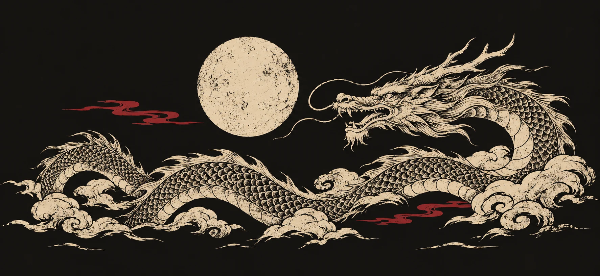
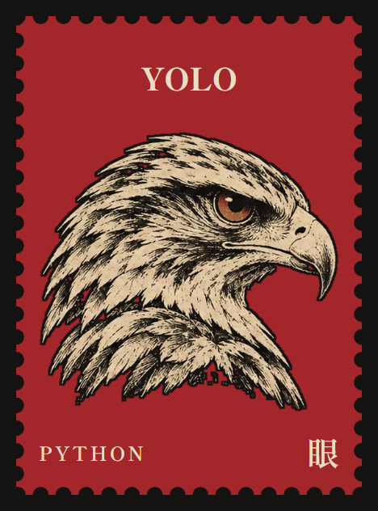
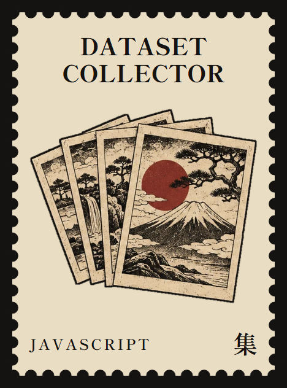
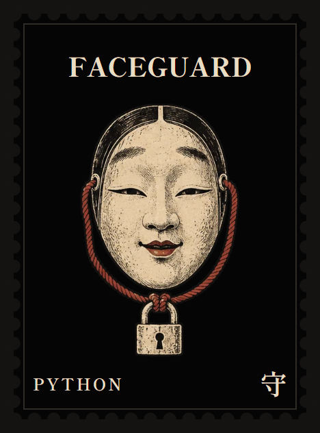
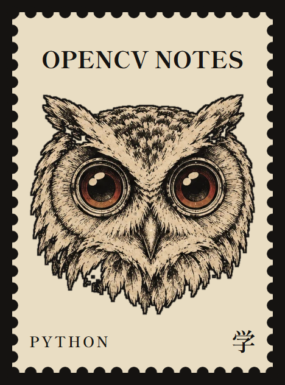
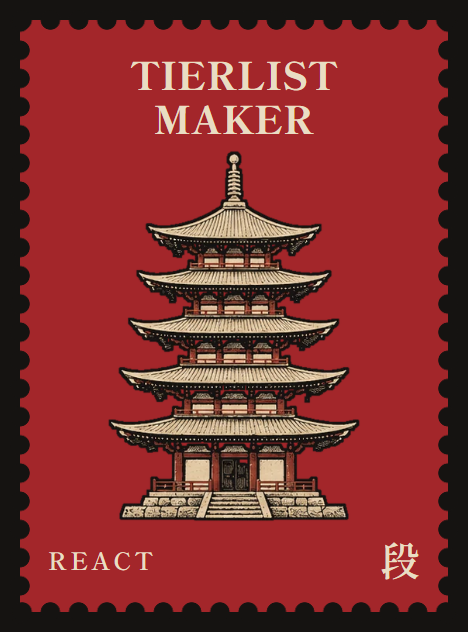

  

# Building toward agents that work.

I'm Enes. My focus now is **large language models, AI agents and automation**.
My public projects so far are mostly computer vision; building in this new direction is what comes next.

`LLMs` · `AI Agents` · `Automation` · `Python`

### Open source

[avenoxbeyin](https://github.com/avenoxai/avenoxbeyin/pull/881) (merged): a persistent memory system for AI coding agents. My fix makes its command line name a refused state write instead of failing with a bare `PermissionError`.

### Earlier work

  
  
  
  
  

<a href="https://enescatalca.github.io">enescatalca.github.io</a>

